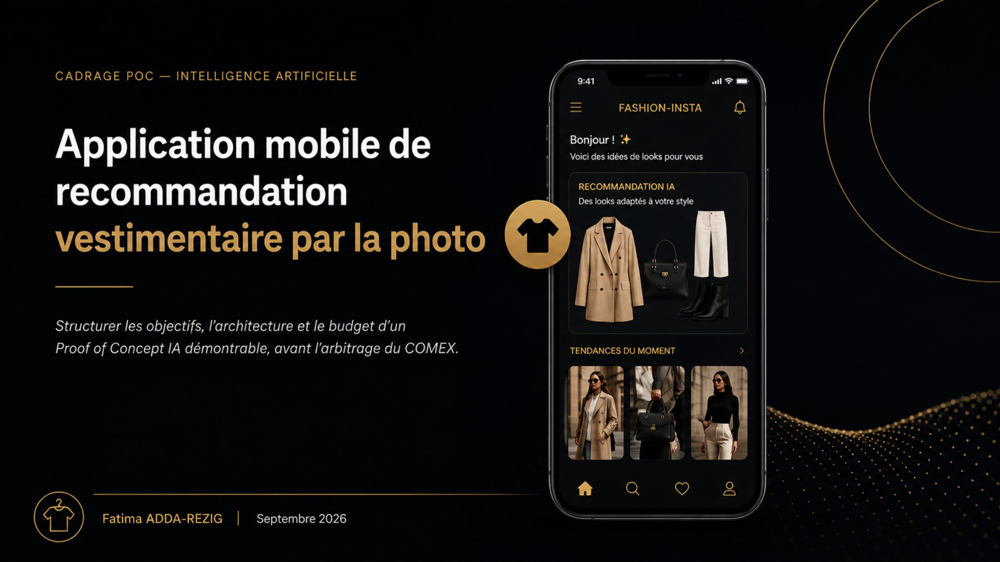
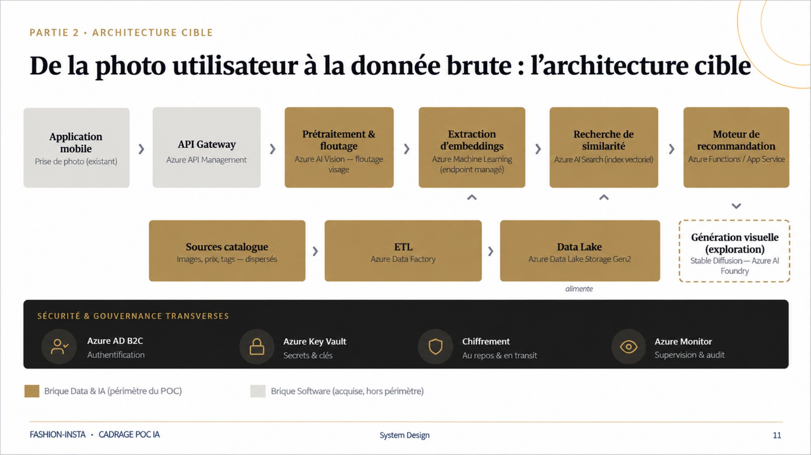
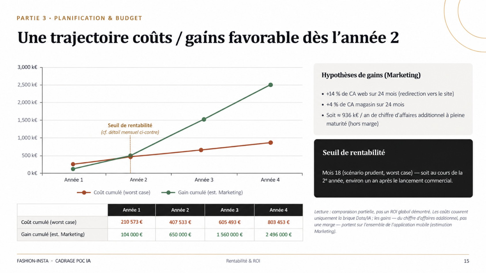

# Cadrage d'un POC IA — Recommandation vestimentaire par la photo

Dossier de cadrage complet d'un projet d'IA, de l'expression du besoin jusqu'à la demande de feu vert au COMEX : périmètre du POC, comparaison de deux approches ML, architecture cible sur Azure, organisation de l'équipe data, chiffrage, rentabilité et conformité RGPD.

> Projet réalisé dans le cadre du parcours *Data Scientist Machine Learning* d'OpenClassrooms. Fashion-Insta est une entreprise fictive ; les chiffres métier et les taux journaliers proviennent des documents fournis pour le projet.



## Contexte

Fashion-Insta, enseigne de mode (11 magasins, site e-commerce, 10,4 M€ de CA), veut lancer une application mobile : l'utilisateur photographie des vêtements qu'il aime et reçoit des articles du catalogue dans le même esprit.

**Mission** : cadrer un Proof of Concept qui démontre la faisabilité de la brique centrale, le moteur de recommandation visuelle, et donner au COMEX les éléments pour décider.

## Ce que contient ce cadrage

| Volet | Contenu |
|---|---|
| **Cadrage fonctionnel** | Besoin métier, valeur ajoutée de l'IA, périmètre volontairement resserré (dans / hors POC) |
| **Approche technique** | Comparaison de deux approches : **A. similarité visuelle** (embeddings CLIP / FashionCLIP + recherche vectorielle) et **B. LLM multimodal** (description de la photo puis filtrage par tags) |
| **Données** | Catalogue interne (875 références), jeux publics de référence (DeepFashion, Polyvore Outfits), aucune donnée personnelle pour le POC |
| **Critères de succès** | Pertinence perçue ≥ 70 % (panel d'experts et d'utilisateurs), Precision@5 ≥ 0,65, temps de réponse < 3 s |
| **Architecture cible** | Chaîne complète sur Azure : API Management, Azure ML, Azure AI Search, Data Factory, Data Lake, Key Vault, Monitor |
| **Organisation** | Matrice des rôles par brique (Data Scientist, Data Engineer, Tech Lead, MLOps), trajectoire POC → MVP → Run, gouvernance |
| **Chiffrage** | Coûts RH et technologiques par phase, scénarios best / worst case |
| **Rentabilité** | Projection mensuelle sur 48 mois et seuil de rentabilité |
| **RGPD** | Risques identifiés par principe (finalité, minimisation, conservation…) et solutions intégrées dès la conception |



## Chiffres clés

| Indicateur | Valeur |
|---|---|
| Durée du POC | 6 semaines, puis MVP de 10 semaines |
| Investissement initial (POC + MVP) | **77 600 €** |
| Coût de fonctionnement annuel | 172 k€ (best case) à 198 k€ (worst case) |
| Gain visé à pleine maturité | 936 k€ de CA additionnel / an (+14 % web, +4 % magasins, estimations Marketing) |
| Seuil de rentabilité | **Mois 18** dans le scénario prudent |

Le gain est exprimé en chiffre d'affaires, hors marge : c'est une hypothèse Marketing, signalée comme telle dans la présentation. Le fichier de chiffrage permet de la faire varier.



## Contenu du dépôt

```
├── docs/
│   └── cadrage_poc_ia.pdf       # présentation COMEX (18 slides)
├── budget/
│   └── chiffrage_poc_ia.xlsx    # modèle de chiffrage paramétrable
└── assets/                      # visuels du README
```

Le fichier Excel est **entièrement paramétrable** : les hypothèses (taux journaliers, durées, staffing, coûts Azure, hypothèses de gains) sont regroupées dans un onglet, et tous les autres onglets (coûts RH, coûts techno, rentabilité, synthèse) se recalculent automatiquement.

## Compétences mobilisées

Cadrage de projet IA · Traduction d'un besoin métier en critères mesurables · Choix d'approche ML · System design cloud (Azure) · Estimation de charge et de budget · Analyse de rentabilité · Protection des données (RGPD, privacy by design) · Communication à un comité de direction

## Auteure

**Fatima ADDA-REZIG** — Data Scientist Machine Learning, ex-ingénieure biochimiste
[Portfolio](https://fatimaadda2878.github.io) · [LinkedIn](https://www.linkedin.com/in/fatima-adda-rezig-72b60b164/)
